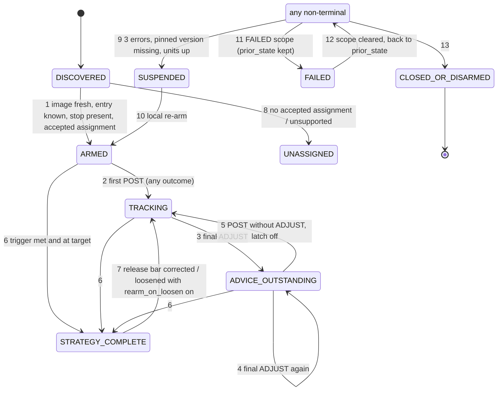
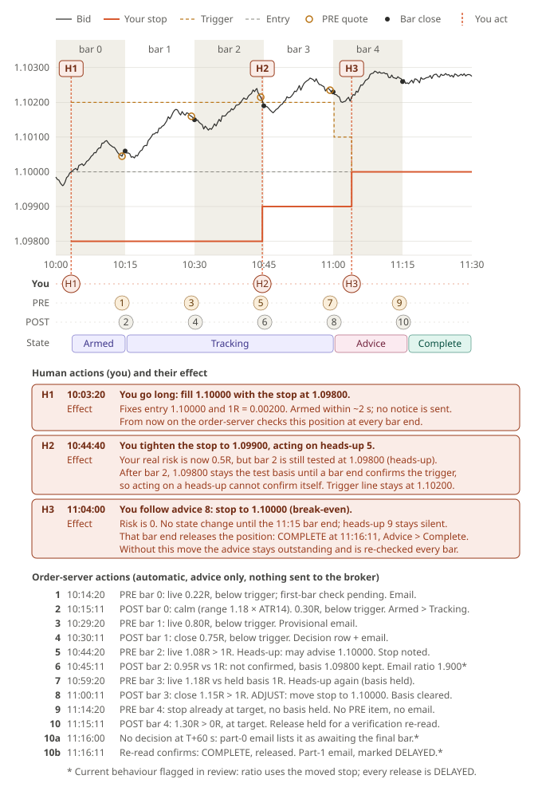
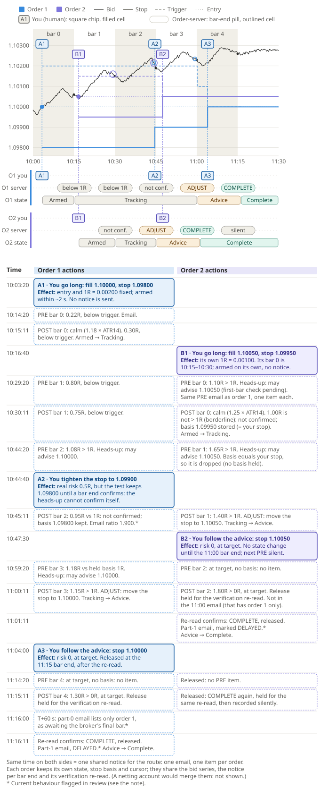

# ARM break-even stop advice: state machine and worked time-price sample

Illustrative sample only. Phase 1 gives advice and notices; nothing is ever sent to a broker.

- **Source of truth:** `docs/design/automated-risk-manager.md` Part B (B6 pipeline, B6.7 defaults, B12 SM11, notices) and the code under `src/riskmgr/` and `src/marketdata/timing.py`.
- **Units:** distances are in R (1R = the first stop distance). No pip size and no money.
- **Checked:** every claim in section 3 was reviewed against the design and code by two independent readers on 2026-11-22.

## 1. State machine (SM11)

| # | From → to | When |
|---|---|---|
| 1 | DISCOVERED → ARMED | Image fresh, entry known, stop present, accepted assignment. Armed on the next 2 s tracker snapshot; no notice is sent. |
| 2 | ARMED → TRACKING | First POST bar-end check, whatever its outcome (FIRST_POST). |
| 3 | TRACKING → ADVICE_OUTSTANDING | A final POST gives ADJUST (FINAL_ADJUST). |
| 4 | ADVICE_OUTSTANDING → itself | Another final ADJUST. The design says "better target"; the code accepts any final ADJUST. |
| 5 | ADVICE_OUTSTANDING → TRACKING | A final POST without ADJUST, latch off (ADVICE_WITHDRAWN). The design also lists "handles reached the proposal" (HANDLES_REACHED), but no code emits it. |
| 6 | ARMED / TRACKING / ADVICE_OUTSTANDING → STRATEGY_COMPLETE | Bar-end check: trigger met and every stop handle at target (RELEASED). It is written only after the bar's verification re-read. |
| 7 | STRATEGY_COMPLETE → TRACKING | The release bar is corrected, or a handle drops below target with `rearm_on_loosen` on. That setting is off by default, in which case you only get one LOOSENED_AFTER_COMPLETE notice. |
| 8 | DISCOVERED → UNASSIGNED / UNSUPPORTED | No accepted assignment, or it cannot be served. One POSITION_NOT_MANAGED notice. |
| 9 | any non-terminal → SUSPENDED | 3 strategy errors, pinned version missing, or units increase. |
| 10 | SUSPENDED → ARMED | Local re-arm. |
| 11 | any non-terminal → FAILED | A FAILED scope covers it; `prior_state` is stored. |
| 12 | FAILED → prior_state | No FAILED scope covers it any more. |
| 13 | any → CLOSED / DISARMED | Terminal. |

A stop move seen between bars has no SM11 edge. Only a bar-end check changes the state.

## 2. Timing of each bar (15m, defaults)

| Moment | When | What runs |
|---|---|---|
| PRE (heads-up) | Local T + p50 − 40 s (`XTNL_ARM_PRE_OFFSET_S`, 30–45 s); valid 10 s | Provisional check on the live bid frozen at fire time. Never actionable, never changes state. Writes a PRE decision row and stores the stop levels it used. PRE email on `pre_channels` (email by default). |
| First broker read | T + p50 + settle | md-bars reads StoneX bar T, then re-reads every 5 s. |
| POST (final) | Bar final after two equal reads ≥ 10 s apart, typically about T + 11 s | Full pipeline on the broker's final bid bar. One fenced transaction: decision row, `arm_positions` CAS, notice row, outbox row. |
| Grace | T + 60 s (`post_grace`) | POST part 0 goes out with whatever is decided. An undecided position shows "awaiting the broker's final bar". Later decisions are marked DELAYED. |
| Verification re-read | min(final + 60 s, decision_cap − 30 s), about T + 71 s | A COMPLETE (release) waits for this re-read. An ADJUST does not wait. |
| decision_cap | T + 15 min + p50 + settle | Still not final means UNRESOLVED. This is also the correction window. |

Per-bar pipeline (first match wins):
- **1–5, pre-guards:** image fresh; stop not stale; effective stop present (otherwise NO_STOP); increment known; not released; broker bar present.
- **6, FirstBarGuard on bar 0:** FIRST_BAR_VOLATILE if high − low > 1.318 × ATR14. It runs at POST only.
- **7, trigger and target:**
  - `favour = σ(close − E)`, `risk = σ(E − S)`, `trigger_met = favour > risk`;
  - `target = E + σ·be_offset_r·max(R, 0)`. With the default offset of 0 this is break-even.
- **7a, release:**
  - trigger met and at target → COMPLETE;
  - at target without the trigger → AT_TARGET_UNCONFIRMED;
  - this bar's PRE gave ADJUST but the bar end did not confirm → PRE_NOT_CONFIRMED, and `pre_basis` is stored.
- **8–13, post-guards:**
  - 8 BROKER_AHEAD;
  - 9 round toward profit;
  - 10 MARKET_CLOSED;
  - 11 DATA_UNAVAILABLE;
  - 12 PRICE_THROUGH_LEVEL when `σ(bid − target) < max(min_gap_r·R, min stop distance, one increment)` (`min_gap_r` defaults to 0);
  - 13 ADJUST.

`pre_basis`:
- A tightening move made after a PRE ADJUST counts at the PRE level for that bar (AT_PRE).
- After PRE_NOT_CONFIRMED, later bar ends (and PREs) test against whichever is farther from entry: the stop at the PRE (S_pre) or the current stop.
- The basis is cleared when a bar end confirms the trigger, or when the stop is loosened back past S_pre.
- Exception: a move that answers an outstanding final ADJUST counts at once (caveat `moved_on_final_advice`).

## 3. Worked time-price sample

- **Trade:** long, illustrative bid prices. E = 1.10000, S₀ = 1.09800, 1R = 0.00200.
- **Bars:** 15-minute bars on the UTC grid. Bar 0 is the bucket holding the fill (`anchor fill_bucket`).
- **Defaults:**
  - route mode every_bar, email only;
  - latch off, `be_offset_r` 0, `min_gap_r` 0, `rearm_on_loosen` off;
  - p50 ≈ 0.
- **Favour figures** are ours, at 0.01 R half-even. A PRE email never shows favour.

The chart separates **what you do** (H1–H3) from **what the order-server does** (1–10b):
- your actions have coral dashed guide lines, coral H chips and their own "You" lane;
- the order-server's checks sit in the PRE and POST lanes.

### Human actions (you) and their effect

| # | Time | What you do | Effect |
|---|---|---|---|
| **H1** | 10:03:20 | Go long: fill at 1.10000 with the stop at 1.09800. | **Fixes entry 1.10000 and 1R = 0.00200.** The order-server arms the position on its next 2 s pass and checks it at every bar end from bar 0 (10:00–10:15). No notice is sent. |
| **H2** | 10:44:40 | Tighten the stop to 1.09900, acting on heads-up 5. | **Your real risk is now 0.5R, but the test does not get easier.** Bar 2 is tested at the heads-up level 1.09800 (AT_PRE). After bar 2, 1.09800 stays the test basis (`pre_basis`) until a bar end confirms the trigger, so acting on a heads-up can never confirm itself. The trigger line stays at 1.10200. Side effect: the bar-2 email shows risk 0.50 R and ratio 1.900.* |
| **H3** | 11:04:00 | Follow advice 8: move the stop to 1.10000 (break-even). | **Risk is 0 and the stop is at target.** Nothing changes until the 11:15 bar end, and heads-up 9 is silent. That bar end releases the position: COMPLETE at 11:16:11, Advice outstanding → Strategy complete. If you do not move it, the advice stays outstanding and is checked again every bar. |

### Order-server actions (automatic, advice only, nothing sent to the broker)

| # | Time | Check | Server action |
|---|---|---|---|
| 1 | 10:14:20 | PRE bar 0, live bid 1.10045 (0.22R) | BELOW_TRIGGER with the label "first-bar check pending at bar end". PRE row written. PRE email (valid until 10:14:30, superseded by the POST). |
| 2 | 10:15:11 | POST bar 0, close 1.10060 (0.30R) | FirstBarGuard: range 1.18 × ATR14, which is calm (≤ 1.318). BELOW_TRIGGER (INFO). ARMED → TRACKING. Decision row and POST email part 0. |
| 3 | 10:29:20 | PRE bar 1, live 1.10160 (0.80R) | BELOW_TRIGGER, PRE email. |
| 4 | 10:30:11 | POST bar 1, close 1.10150 (0.75R) | BELOW_TRIGGER, decision row and email. Stays TRACKING. |
| 5 | 10:44:20 | PRE bar 2, live 1.10215 (1.08R > 1R) | Provisional ADJUST to 1.10000, email headed "PROVISIONAL, final advice after the bar closes", valid until 10:44:30. The stop level it used (1.09800) is stored on the PRE row. State unchanged. |
| 6 | 10:45:11 | POST bar 2, close 1.10190 (0.95R vs 1R) | PRE_NOT_CONFIRMED(BELOW_TRIGGER), INFO, shown: "bar end did not confirm … still managed". `pre_basis` = 1.09800 stored. Stays TRACKING. * |
| 7 | 10:59:20 | PRE bar 3, live 1.10235 (1.18R vs held basis 1R) | Provisional ADJUST to 1.10000 with caveat `pre_basis_held`, PRE email. |
| 8 | 11:00:11 | POST bar 3, close 1.10230 (1.15R > 1R) | Trigger met; target 1.10000. The stop (1.09900) is short of it; post-guards pass (bid 1.10225). ADJUST (ACTIONABLE): "move the stop to 1.10000 … only if your stop is still worse than this". `pre_basis` cleared. TRACKING → ADVICE_OUTSTANDING. Email; the HTML levels block may show stop distance from entry in pips. |
| 9 | 11:14:20 | PRE bar 4 | Stop already at target with no basis held, so there is no PRE item and no PRE email for this position. |
| 10 | 11:15:11 | POST bar 4, close 1.10260 (1.30R > 0R) | Trigger met and at target. The release is held for the verification re-read: only `pending_event` is written, with no decision row. |
| 10a | 11:16:00 | Grace ends (T + 60 s) | POST part 0 lists the position as "awaiting the broker's final bar", although the bar is final and only the release is held. * |
| 10b | 11:16:11 | Verification re-read confirms the bar | COMPLETE written. ADVICE_OUTSTANDING → STRATEGY_COMPLETE. POST part 1, marked "DELAYED: decided 1 min after bar end", reads "released: the bar end confirmed break-even; the ARM no longer manages this position (if the stop is moved back below the target later, you are told only)". * |

The trigger line on the chart is where favour first exceeds risk:
- **10:03:20 to 11:00:11, at 1.10200 (1R):** risk is measured from S₀, then from the PRE level after 10:44:40, then from `pre_basis` after 10:45:11.
- **11:00:11 to 11:04:00, at 1.10100 (0.5R):** the basis was cleared and the stop is 1.09900.
- **From 11:04:00, at entry:** risk is 0.

### Branches from the same trade

- **Bar 0 volatile.** Bar 0's range is 1.5 × ATR14 (> 1.318), so step 6 gives FIRST_BAR_VOLATILE (HOLD). The state still goes ARMED → TRACKING, because the first POST moves it whatever the outcome.
- **Price through the level at bar 3.** The close is 1.10230, but the bid at POST is 1.10000.
  - The gap is 0, below one increment, so step 12 gives PRICE_THROUGH_LEVEL (HOLD, shown): "price is too close to or through the proposed level; no move".
  - It is not PRE_NOT_CONFIRMED. trigger_met is still recorded, so `pre_basis` is cleared, and the next bar tests at the current 1.09900 (0.5R).
  - The state stays TRACKING.
- **Advice not acted on.** You leave the stop at 1.09900 and bar 4 closes at 1.10150 (0.75R > 0.5R).
  - The trigger is met again and ADJUST is re-proposed. The state stays ADVICE_OUTSTANDING.
  - If a post-guard gives a HOLD instead, the advice is withdrawn: ADVICE_OUTSTANDING → TRACKING. There is no separate "withdrawn" text; the item shows its own outcome.
- **Loosened after release.** After STRATEGY_COMPLETE the stop is dragged back to 1.09950.
  - Default (tell only): one LOOSENED_AFTER_COMPLETE notice.
  - With `rearm_on_loosen` on: STRATEGY_COMPLETE → TRACKING.

## 4. Design 2: two concurrent positions

Two long positions on the same instrument and the same ARM route share one bid price/time chart.

- **Order 1 (blue)** is the trade from section 3. Its actions are in the left column.
- **Order 2 (purple)** fills at 10:16:40 at 1.10050 with the stop at 1.09950 (its own 1R = 0.00100). Its actions are in the right column.
- **The table** runs in one time sequence. A row with cells on both sides happened at the same moment.
- **Telling actions apart:** human actions are square chips (A1–A3, B1–B2) and colour-filled boxes with a bold **Effect**. Order-server actions are bar-end pills and dashed outlined boxes.

Order 2, step by step:

| Time | Who | What happens to order 2 |
|---|---|---|
| 10:16:40 | **You (B1)** | Go long at 1.10050, stop 1.09950. **Effect:** its own entry, 1R and bar 0 (10:15–10:30). It is armed on its own row; no notice. |
| 10:29:20 | Server | PRE bar 0: 1.10R > 1R, a heads-up that it may advise 1.10050, with "first-bar check pending". Goes in the **same PRE email as order 1**, one item each. |
| 10:30:11 | Server | POST bar 0: calm (1.25 × ATR14). The close gives exactly 1.00R, and the trigger is strict (favour **>** risk), so it is not met (caveat `borderline`). Outcome PRE_NOT_CONFIRMED; `pre_basis` 1.09950 stored, which equals your stop. Armed → Tracking. |
| 10:44:20 | Server | PRE bar 1: 1.65R > 1R, heads-up again. The stored basis is not farther from entry than your stop, so it is dropped: no `pre_basis_held` caveat. |
| 10:45:11 | Server | POST bar 1: 1.40R > 1R. ADJUST: move the stop to 1.10050. Basis cleared. Tracking → Advice outstanding. Same POST email as order 1's PRE_NOT_CONFIRMED. |
| 10:47:30 | **You (B2)** | Move the stop to 1.10050. **Effect:** risk 0, at target. No state change until the 11:00 bar end; the 10:59:20 PRE has no item for order 2. |
| 11:00:11 | Server | POST bar 2: 1.80R > 0R, at target. The release is held for the verification re-read. Order 2 is **not** in the 11:00 email, which carries only order 1's ADJUST. |
| 11:01:11 | Server | Re-read confirms: COMPLETE, released. Part-1 email, marked DELAYED. Advice outstanding → Strategy complete. |
| 11:14:20 / 11:15:11 | Server | Released: no PRE item. Its 11:15 COMPLETE is held for the same re-read as order 1, then recorded silently. The 11:16:00 "awaiting" email lists only order 1. |

What the two positions share and what they don't (checked against the code):

- **Separate:** each order has its own `arm_positions` row, cursor, `pre_basis`, SM11 state and decisions. A move on one stop never changes the other's test.
- **Shared:**
  - one notice per route, event and bar end: one email, one item per order;
  - one fenced transaction per bar end, with a savepoint per position;
  - the bid series and its verification re-read, so releases on the same bar are confirmed together;
  - any FAILED scope on the series, adapter or strategy version, which covers both.
- **Assumes one position per opening order** (StoneX). On a netting account the second fill would be a units increase on one position, and that position would be SUSPENDED. That case is not shown.
- Nothing is sent to the broker for either order.

## 6. Design 3: live stop adjustment (Phases 3–5)

**Design proposal only; nothing is built.** Phase 1 stays read-only. The full design is in [live-adjust.md](live-adjust.md). It covers:

- **Prerequisites** before any live phase: a stop-tighten gate kind with the full freshness checks; single in-place amends only; broker probes; an off-PC dead-man receiver; your decisions.
- **Autonomy phases:** 3 (you approve each move), 4 (automatic, you are notified), 5 (autonomous; routine notices can be off, safety alerts stay on).
- **The new SM13 state machine** for each stop-move intent: [live-sm13.svg](live-sm13.svg).
- **Scenarios**, each with one order and two concurrent orders:
  - [A: heads-up, then the original stop is hit](scenario-a.svg)
  - [B: take profit in the first 10 minutes](scenario-b.svg)
  - [C: volatile first bar](scenario-c.svg)
  - [D: control](scenario-d.svg)
- **Crashes with and without recovery** (K1–K8): [live-crash.svg](live-crash.svg).
- **30 edge cases**, and **your decisions D1–D6** (made 2026-11-22): full safety alert list; a stop you touch is yours until you hand it back; no sends under HARD_HALT; a 60 s Phase 3 approval window; a local approval page (phone access later through a tunnel); live moves resume with a SAFE_HOLD auto-resume.

**UI prototypes** for these decisions are in [../live-adjust-prototypes/](../live-adjust-prototypes/README.md): approvals, stop ownership, live mode, alerts and notices, in the XTNL theme, with desktop and phone screenshots.

Figures are regenerated by `gen_live_scenarios.py` (data in `live_scenarios_data.py`) and `gen_live_sm_crash.py`.

## 5. Findings from the review (current code, not changed)

* Marked rows in sections 3 and 4. Numbers below refer to the order-server table.

1. **Misleading ratio after a heads-up move (server row 6, after H2).** The email's `current risk` comes from the current stop (1.09900 = 0.50 R), and favour / risk is computed from it. The bar-2 email therefore reads "favour 0.95 R; favour / risk 1.900" beside "bar end did not confirm", which looks like the trigger was met. The test actually used 1R (AT_PRE). The same applies at server row 8, where the email shows 2.300 against a tested 1.15.
   - Code: `src/riskmgr/evaluation.py:792`, `src/riskmgr/render.py:516-519`.
2. **Every release is DELAYED and preceded by an "awaiting" email (server rows 10a/10b).** The verification re-read lands at about final + 60 s ≈ T + 71 s, after `post_grace` (T + 60 s). So POST part 0 lists the position as awaiting a bar that is already final, and the COMPLETE follows in part 1 marked DELAYED. Under default timing this happens on every release.
   - Code: `src/marketdata/timing.py:149-153`, `src/riskmgr/notices.py:933-955`, `src/riskmgr/barclock.py:873-876`.
3. **HANDLES_REACHED is never emitted.** Design B12 lists ADVICE_OUTSTANDING → TRACKING when the handles reach the proposal, and `src/riskmgr/sm11.py:81` has the edge. Nothing emits the event, so the state stays ADVICE_OUTSTANDING until the next bar-end check.
4. **The design's "better target" self-loop is not enforced.** The code keeps ADVICE_OUTSTANDING on any final ADJUST.
5. **Design §0 Q9 still lists an "armed" notice item.** None is built, and no notice is sent on arming.
