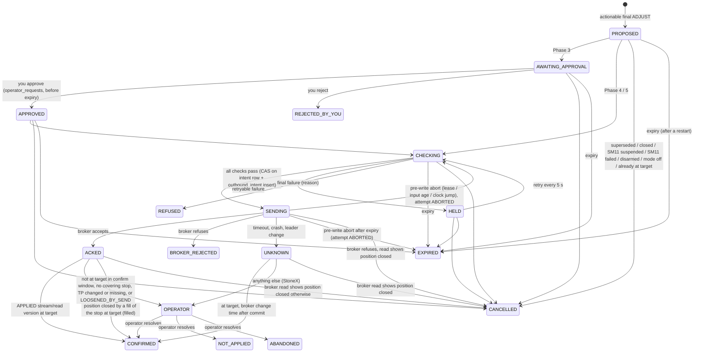

# Design 3: live stop adjustment (Phases 3–5), scenarios, edge cases and crashes

**Status: design proposal only (v3, after two adversarial review rounds). Nothing here is built.**
- Phase 1 stays read-only: no sender, no intent writer, no adapter mutation method.
- Building any of this needs the Phase 2 infrastructure first (ARM design §B10, operations §5), then the prerequisites in §0, then its own reviewed design.

Conventions:
- **Strategy:** break-even on risk close with the defaults of designs 1 and 2 (15m bars, PRE 40 s before bar end, POST about T + 11 s, release after the verification re-read at about T + 71 s).
- **Units:** distances in R; no pip size, no money. Prices are illustrative bid. Every rule says "exit-side quote": bid for a long, ask for a short.

## 0. Prerequisites (blockers before any live phase)

| # | Prerequisite | Why |
|---|---|---|
| P1 | **A new `Action.kind = STOP_TIGHTEN` in `ActionGate`.** It is allowed under SOFT_HALT like a risk-reducing action, but it applies the full freshness list used for risk-increasing actions: settle window, reconciled after the latest open in this epoch, no open stream_health, catch-up verified, no stale_mark, no UNKNOWN result, RiskSweep pass current. | Today `evaluate_gate` returns *allowed* for any non-risk-increasing action before checking any of these (`src/oversee/gate.py:92-95`). Without this, a new leader could send a tighten from a stale image during the 22 s settle window. |
| P2 | **The stop move must be one broker request that changes the existing stop's trigger price in place.** No client-side cancel + new order, and no bracket re-submit. An adapter whose amend is a cancel/replace is refused unless the broker makes it atomic (probe-verified). The amend carries the trigger price and handle id only, never a quantity. On cTrader it carries the current take profit unchanged. | Otherwise a crash or reject between the cancel and the new order leaves the position **with no stop**, and a quantity in the payload can over-cover after a partial close. |
| P3 | **Probe evidence, per adapter, that:** (a) the order version (StoneX `LastChangedDateTimeUTC`) changes on every stop amend; (b) manual stop moves appear on the stream; (c) how our own amend can be told apart from a manual one. **Plus an operations rule change:** resolving UNKNOWN by level and broker change time departs from operations §5 (which allows only a `client_order_id` match or an operator) for adapters without client ids. | All version checks and UNKNOWN resolution rest on these. StoneX has no client order ids (§B10 "StoneX resolution without client ids" is open). |
| P4 | **A working off-PC dead-man receiver, checked continuously.** | Without it, a dead PC or a dead supervisor tells nobody. |
| P5 | **Your decisions (§6) — made 2026-11-22.** Their consequences are now part of this design. | Approval rules, ownership after a manual move, and which alerts survive "notifications off" are your call. |

## 1. Autonomy phases

| Phase | Who moves the stop | Before the move | After the move |
|---|---|---|---|
| 1 (today) | You, in the broker platform | Advice notice ("move the stop to X … only if your stop is still worse") | Nothing; the next bar end sees your move |
| 2 | Infrastructure only: intents, gate kind, send rules | n/a | n/a |
| **3 — approve** | The order-server, **only after you approve** | Approval request (email + push, high), **open for 60 s** (D4), answered on the **local approval page** (D5): "approve moving the stop to X (intent id, expires HH:MM:SS)" | Result notice |
| **4 — auto + notify** | The order-server, automatically | The ADJUST item says "the order-server will move the stop to X (intent id)"; it never asks you to act | Result notice (below) |
| **5 — autonomous** | The order-server, automatically | Optional | Routine notices can be off; the always-on list (D1) still pages |

**Result notice:** its own ARM notice event, keyed by intent id.
- Holds the stop level before and after, the outcome and times only. Pips from entry are allowed in the HTML part; never favour R or quotes.
- Outcomes: CONFIRMED, REFUSED(reason), EXPIRED, CANCELLED(reason), BROKER_REJECTED, UNKNOWN, OPERATOR, BLOCKED_BY_OPEN_INTENT.

Rules that hold in every live phase:
- **Only actionable bar-end decisions act.** An intent comes only from an `advice = true` ADJUST row that is the newest by `decision_seq`: POST (also DELAYED), LATE, REOPEN, or a CORRECTED revision of the latest decided bar. It must not be superseded, must be within its maximum age, and must have no FAILED episode covering it now or since it was decided. An unreadable FAILED state counts as FAILED.
- **PRE never acts.** It can say "an approval request is likely at bar end" (Phase 3), but there is nothing to approve before the POST.
- **Tighten only.** The target must be strictly tighter than the stop read just before the send. A residual race remains: you tighten past the target in the last second, and the amend sets it back to the target. Where the broker offers a conditional or versioned amend, the transport uses it. After the ack, a confirming read pages **LOOSENED_BY_SEND** (critical) and blocks the handle when either holds: any stream or read version with a broker time between the CHECKING re-read and the ack showed a level tighter than the target (your move was overwritten), or the final level is looser than the CHECKING re-read. This rests on P3(b).
- **One open intent per stop handle.** The handle is identified by its broker order id, or POSITION_FIELD, never by rank. Enforced by `UNIQUE (adapter_id, position_id, handle_broker_id) WHERE state NOT IN (<terminal states>)` on `stop_move_intent`.
- **A durable live-mode switch** (PostgreSQL, fenced, audited) is read in the same statement that moves an intent to SENDING. The following cancel every intent that has not been sent, in one transaction: switching live off, lowering the phase, an ARM pause, a local disarm, or losing the dead-man receiver. An unreadable switch counts as off. A lower phase never inherits an intent created under a higher one.

## 2. State machines

- **SM11, per position:** unchanged — Discovered, Armed, Tracking, Advice outstanding, Strategy complete, Closed, Disarmed, Suspended, Failed. (Unassigned and Unsupported are tracker outcomes, not SM11 states.)
- **SM13 (new), per stop-move intent:** one intent per stop handle, per actionable ADJUST. It is one pure transition table, like `sm11.py`; every (state, event) pair not listed is refused.

SM13 reacts to SM11 and the broker; SM11 does not react to SM13. Release still comes only from a bar end that sees the stop at target. `HANDLES_REACHED` exists in the design but is not emitted today; if it is built, a CONFIRMED move would take the position back to Tracking, and release would still need the bar end.

### SM13 states

| State | Meaning | Leaves when |
|---|---|---|
| **PROPOSED** | A row in a new `stop_move_intent` table, written by a future stop-move sink in the same fenced savepoint as the ADJUST decision. Its id is a hash of the decision key and the handle's broker id. It holds the expected broker version, target, current take profit, mode (pinned) and expiry. In the same savepoint, an older open intent on the handle that has not been sent is CANCELLED(superseded). If an older intent is SENDING, ACKED, UNKNOWN or OPERATOR, the decision still commits but no intent is made: BLOCKED_BY_OPEN_INTENT is recorded and paged. A sink failure fails the decision transaction, as a notice failure does. | Phase 3 → AWAITING_APPROVAL; Phases 4/5 → CHECKING; cancel triggers → CANCELLED; expiry (after a restart) → EXPIRED |
| **AWAITING_APPROVAL** | Phase 3. Approval is an `operator_requests` row (kind `arm_approve_intent`, intent id) answered by the leader as applied, refused or moot, under the fence, with its `operator_audit` row. A duplicate is answered moot. | approve → APPROVED; reject → REJECTED_BY_YOU; expiry → EXPIRED; cancel triggers → CANCELLED |
| **APPROVED** | The approval is committed. **Only APPROVED Phase 3 intents may enter CHECKING.** After a crash an intent resumes in its committed state, so a Phase 3 PROPOSED or AWAITING_APPROVAL intent never goes straight to CHECKING. | → CHECKING; expiry or cancel triggers |
| **CHECKING** | Checks, each with its read time: (1) position OPEN; SM11 not Closed, Suspended or Failed. (2) Decision still actionable (§1) and not expired. (3) Live-mode switch on at this phase. (4) `ActionGate.allow(STOP_TIGHTEN)` (P1). (5) Symbol open (SM10). (6) Broker re-read of the handle through the normal ingestion path: same broker version, or only a tighter level still short of the target. The handle must be a POSITION_FIELD, or a reduce-only child linked to this OPEN position that is untriggered (not PARTIALLY_FILLED) and whose remaining units cover the position. The take profit must be unchanged. (7) Exit-side quote at least max(min_gap_r·R, min stop distance, one increment) on the profit side of the target. (8) Target strictly tighter than the current stop. | all pass → SENDING. **Retryable** (gate denied, SM8 or settle, market closed, stale or rate-limited read, quote not live) → HELD. Check (1) fails or SM11 Closed / Suspended / Failed / Disarmed, superseded, mode off, or **already at or past target** → CANCELLED(reason). Expired → EXPIRED. **Final** (an `arm_failures` episode covering the decision, version changed, loosening, triggered stop, not reduce-only, price through level) → REFUSED(reason). |
| **HELD** | Waiting on a retryable reason (for example `hard_halt`, `market_closed`, `settle`). Re-checked every 5 s by a level-triggered pass. There are no timers; every deadline is a durable timestamp. | → CHECKING; expiry → EXPIRED (paged in Phases 4/5); cancel triggers |
| **SENDING** | One fenced statement: `UPDATE stop_move_intent SET state='SENDING' WHERE id=$1 AND state='CHECKING' AND row_version=$2 AND <switch / approval predicates>`, plus `INSERT outbound_intent(client_order_id = 'sm:'‖intent‖':'‖attempt, state 'SENDING') ON CONFLICT DO NOTHING`. Zero rows → abort. Then, with no await before the socket write: `now < lease_deadline − max_send_time`, the oldest CHECKING input at most 1 s old, and the sleep-inclusive clock has not jumped. | broker answer → ACKED or BROKER_REJECTED; a broker refusal with a read showing the position closed → CANCELLED(position_closed), not BROKER_REJECTED; a pre-write abort → attempt ABORTED, back to CHECKING if not expired, else EXPIRED; no answer, crash or leader change → UNKNOWN |
| **ACKED** | The broker accepted. A confirming read follows. | an APPLIED stream or stop-read version (with a real broker time, via the orchestrator, so S_at_T sees it) at target and the take profit unchanged → CONFIRMED. Not at target within the confirm window (30 s), no covering stop (NO_STOP), the take profit changed or missing, or LOOSENED_BY_SEND → OPERATOR (critical). The position closed by a fill of the stop at target → CONFIRMED(filled); closed otherwise → CANCELLED(position_closed). |
| **UNKNOWN** | Outcome unknown. **Never re-sent.** The new leader marks earlier-epoch SENDING rows UNKNOWN at LEADER_INIT **and again when the settle window ends**, because an old-term commit can land after the bump. No intent leaves PROPOSED, HELD or CHECKING before that second sweep. | at target, shown by an APPLIED stream or stop-read version via the orchestrator with a broker change time after the intent's commit → CONFIRMED(observed, unattributed), treated as possibly your move (D2). Position closed → CANCELLED. Anything else → OPERATOR. On StoneX, UNKNOWN never becomes NOT_APPLIED automatically; only an adapter that echoes a client id may do that. |
| **OPERATOR** | Paged (critical), re-paged every 30 min while open; blocks the handle. If the position closes, it stays OPERATOR and is re-paged until resolved (ABANDONED is the expected answer). | the operator resolves (audited, intent id named) → CONFIRMED, NOT_APPLIED or ABANDONED |
| **Terminal** | CONFIRMED, REFUSED, EXPIRED, CANCELLED, BROKER_REJECTED, NOT_APPLIED, ABANDONED, REJECTED_BY_YOU. The `outbound_intent` attempt maps to RESOLVED (`resolved_by` = observed_at_target, broker_rejected, not_applied, operator) or ABORTED. | A new intent for the handle needs a new decision and no open intent on that handle |

**Every non-terminal state has a durable deadline** (no timers; a level-triggered pass checks them):

| State | Deadline |
|---|---|
| AWAITING_APPROVAL, APPROVED, CHECKING, HELD | expiry |
| SENDING | the broker answer timeout |
| ACKED | the confirm window |
| UNKNOWN | the first broker read after the second sweep |
| OPERATOR | its re-page cadence |

**Expiry** = the earliest of:
- the event's cap: for POST, LATE and CORRECTED that is the bar's decision_cap (about the end of the next bar); for REOPEN it is the REOPEN window end;
- `decided_at_ms + max_decision_age`: a local setting of 60 s in every live phase (D4: in Phase 3 your approval must arrive within 60 s of the decision);
- `bar_end + max_bar_age`: a local setting, never later than the decision_cap. For REOPEN the age is measured from the first OPEN instant + settle instead of the bar end;
- a monotonic deadline taken at creation, so a wall-clock step back cannot extend it.

**Several stop children** (they cover the units together): one intent per child, created in one transaction, sent serially farthest-first. The group counts as moved only when all are CONFIRMED. A partial result pages, and the next bar re-proposes only the children still short of target. No child ever moves past its target.

## 3. Scenarios (one order, then two concurrent orders)

Each scenario has its own figure, `scenario-a.svg` to `scenario-d.svg`:
- **Order 1 (blue)** is the single-order case.
- **Order 2 (purple)** runs at the same time on the same instrument and account.
- Per order, lanes show the order-server's bar-end outcome, the stop move under Phases 4/5, the stop move under Phase 3, and the SM11 state.
- Fills by the broker are marked ◆. Stop fills are market fills: slippage in a fast move is possible.

### D — control: nothing special

Order 1: fill 10:03:20 at 1.10000, stop 1.09800. Order 2: fill 10:16:40 at 1.10050, stop 1.09950. The path is the one from designs 1 and 2, and you never touch the stop.

| Time | Order 1 | Order 2 |
|---|---|---|
| 10:29:20 / 10:30:11 | Below trigger | Conditional heads-up (bar 0, first-bar check pending); then 1.00R is not > 1R → not confirmed |
| 10:44:20 | Heads-up (provisional; never an intent) | Heads-up |
| 10:45:11 | Not confirmed (0.95R) | **ADJUST → intent I2** (target 1.10050) |
| P4/P5 | — | 10:45:12 I2 CONFIRMED: stop at 1.10050 |
| P3 | — | Approval request 10:45:12; you approve 10:45:50 (within 60 s) → CONFIRMED 10:45:51 |
| 11:00:11 | **ADJUST → intent I1** (target 1.10000) | At target → release held → 11:01:11 COMPLETE |
| P4/P5 | 11:00:12 I1 CONFIRMED | — |
| P3 | You approve 11:00:50 → CONFIRMED 11:00:51 | — |
| 11:15:11 | P4/P5, or P3 approved: at target → 11:16:11 COMPLETE | — |
| 11:15:11 (P3 not approved) | I1 EXPIRED at 11:01:11 (60 s, D4). ADJUST again (1.30R) → new intent I1′. Release no earlier than the 11:30 bar (11:31:11). | — |

### A — heads-up, then the original stop is hit before bar end

- **Path:** as in design 1 to the heads-up at 10:44:20 (1.10215). Then a spike to 1.09790 by 10:44:50; bar 2 closes at 1.09830.
- **Order 1:** fill 10:03:20 at 1.10000, stop 1.09800.
- **Order 2:** fill **10:05:00** at 1.10020, stop 1.09940 (1R = 0.00080). Its bar 0 is 10:00–10:15, the same calm bar as order 1 (1.18 × ATR14).

**Order 1.**
- 10:44:20: heads-up (1.08R). **No intent:** PRE never acts.
- ~10:44:48: the spike triggers the original stop at 1.09800. It fills at or below that level, so a loss of about 1R or slightly worse. **CLOSED**; the tracker sees it within 2 s.
- 10:45:11: nothing (closed positions get no POST). The delivered heads-up cannot be retracted. The proposed "ended" notice (E19) says closed by stop.

**Order 2.**
- 10:15:11, bar 0: 0.50R, below. 10:29:20: heads-up (1.75R). 10:30:11, bar 1: 1.62R > 1R → **ADJUST → intent I2** (target 1.10020).
- **P4/P5:** CONFIRMED 10:30:12. The spike triggers the stop at 1.10020 at about 10:44:40. It fills at or below that level: much better than −1R, but not guaranteed exactly at break-even.
- **P3:** you do not answer within 60 s, so I2 EXPIRES at 10:31:11 (D4). The 10:45 bar would propose again, but the spike comes first: it hits the original 1.09940 at about 10:44:43, a loss of about −1R or worse.

Shared: both closes are broker fills. The server sends nothing during the spike.

### B — take profit within the first 10 minutes

**Order 1:** fill 10:03:20 at 1.10000, stop 1.09800, take profit 1.10090.
- Armed 10:03:22.
- 10:11:00: TP fill → **CLOSED**; the broker cancels the stop child (OCO). The tracker writes CLOSED by about 10:11:02.
- No PRE, no POST, no intent. "Ended" notice (proposed).

Edge B′: a TP or stop fill within 2 s of entry, before the first tracker pass, means the position is never armed and the ARM never records it.

**Order 2:** fill 10:07:00 at 1.10035, stop 1.09955 (1R = 0.00080), no take profit.
- Bar 0: 0.31R, below.
- 10:30:11, bar 1: 1.44R → **ADJUST → intent** (target 1.10035). P4/P5: CONFIRMED 10:30:12. P3: approved 10:30:50 → CONFIRMED 10:30:51.
- 10:45:11, bar 2: at target → 10:46:11 COMPLETE. Order 1's close never touches order 2.

### C — first bar too volatile: trailing starts one bar late

**Order 1:** fill 10:03:20 at 1.10000, stop 1.09800. Bar 0 ranges from 1.09900 to 1.10260 and closes at 1.10230: 3.1 × ATR14, above 1.318.
- 10:14:20: conditional heads-up (1.20R, "first-bar check pending").
- 10:15:11: **PRE_NOT_CONFIRMED(FIRST_BAR_VOLATILE)**, INFO, even though 1.15R > 1R. pre_basis 1.09800 is stored (equal to the stop, so bar 1 tests at 1R). **No intent.** Armed → Tracking.
- 10:30:11, bar 1: 1.25R → ADJUST → intent → CONFIRMED 10:30:12 (P4/P5), or at approval (P3).
- 10:45:11: at target → 10:46:11 COMPLETE.
- The move comes one bar (15 min) later than on a calm first bar. The original stop protects in the meantime.

**Order 2:** fill 10:18:00 at 1.10220, stop 1.10140 (1R = 0.00080). Its own bar 0 is 10:15–10:30, range 0.00080: calm (about 0.6–0.7 × ATR14, depending on how much order 1's wide bar lifted ATR14), so **not held**. The guard is per position.
- 10:30:11: 0.38R. 10:45:11: 0.75R.
- 11:00:11: 1.38R → ADJUST → intent → CONFIRMED.
- 11:15:11: at target → 11:16:11 COMPLETE.

## 4. Crash: with and without recovery

**Baseline:** the stop is a resting order at the broker. With P2 (single in-place amend only), whatever stop the broker last accepted keeps protecting the position while the server is down. A crash can lose or delay a **move**, but it cannot remove a stop. Without P2 that claim is false: a half-done cancel + place could leave no stop.

| Crash point | Without recovery (stays down) | With recovery (restart / failover) |
|---|---|---|
| **K1** — between PRE and POST (no decision yet) | No decision, no move; the broker keeps the old stop. Alerts: see E18. | Restart: back-off 5 s doubling to 120 s, plus up to the 15 s lease TTL; LEADER_INIT up to 120 s. **Before that bar's decision_cap** the bar is decided as a POST (caveat `delayed` after T + 60 s), or as LATE if the route's POST notice already went. Both are actionable within max age, so an intent can still be made. **After the cap** the bar is UNRESOLVED_RANGE(downtime), no intent, and the next bar decides normally. |
| **K2** — intent PROPOSED, AWAITING_APPROVAL, APPROVED, CHECKING or HELD (not sent) | Nothing is sent; the old stop stays. Phase 3: approving does nothing while the server is down. | The intent resumes **in its committed state, under its pinned mode**. Phase 3 never skips approval. Once the gate opens (P1: the max of SM8 READY, term start + 22 s, reconcile and catch-up) and the second UNKNOWN sweep has run, it re-checks. Within expiry it can send; past expiry → EXPIRED (paged in Phases 4/5). In Phases 4/5 (60 s max age) a send is rare: restart plus gate opening usually outlasts it, so the intent expires and the next bar decides again. |
| **K3** — SENDING (the request may or may not have reached the broker) | Unknown whether the stop moved. The broker has the old or the new stop; with P2 both protect. | The new leader marks it UNKNOWN (twice, see SM13), then a broker read. At target with a change time after the commit → CONFIRMED(observed, unattributed). Otherwise → **OPERATOR, paged; the handle stays blocked** (StoneX cannot prove "not applied"). **Never re-sent.** |
| **K4** — Phase 3, waiting for approval | The request was delivered; approval cannot be processed. | Approval rows are durable. An approval after recovery and before expiry is applied; after expiry it is answered refused. With the 60 s window (D4), a crash during it almost always ends in EXPIRED; the next bar end proposes again. |
| **K5** — ACKED, before the confirming read | The broker has the new stop, or the old one (if it changed its mind). Both protect. | The confirm window is re-evaluated from the durable timestamp: at target → CONFIRMED; otherwise → OPERATOR. |
| **K6** — after CONFIRMED, before release | The stop is already at break-even at the broker. | The next bar end sees the stop at target and releases. A verification re-read lost from memory is redone. |
| **K7** — PC power loss or sleep | Nothing runs until you log on (single-PC task). The broker stop protects. | Sleep longer than the 12 s fence → exit 75 → restart. Missed bars → UNRESOLVED_RANGE(downtime), one notice line per position. Old intents past expiry → EXPIRED. |
| **K8** — crash loop | — | SAFE_HOLD (3 abnormal terms within 15 min, or more than 6 epoch changes in 30 min): gate closed, nothing sent, one page. ARM FAILED(unclean_restarts) (3 lost or init_failed terms within 30 min while armed, sleep-fence restarts excluded): every intent refused until an operator clears it. **Single-PC SAFE_HOLD auto-resume also resumes live moves (D6, your choice).** The resume is paged, every send still passes the full checks, and ARM FAILED(unclean_restarts) still blocks every intent until an operator clears it. |

Recovery targets (operations):
- engine crash: about 30–60 s;
- node or AZ lost: about 45–90 s;
- Redis lost: gate closed for about 10–30 s.

The ARM is decisive again once its broker bar series is LIVE (design test: before the next POST).

## 5. Edge cases

| # | Case | Proposed handling |
|---|---|---|
| E1 | You move the stop yourself while an intent is open | **Any manual move makes the handle human-owned (D2).** An unsent intent → CANCELLED(human_owned), and no new intent is made for that handle until you hand it back. A move during the send is caught by the confirming read (LOOSENED_BY_SEND). |
| E2 | You **loosen** (or tighten) the stop | As E1: human-owned until you hand it back (D2). The server keeps advising but never sends for that handle, so it never fights you. Hand-back is an audited ops request. |
| E3 | Price runs through the target before the send | Check 7 fails → REFUSED(price_through_level). The old stop stays. |
| E4 | The broker rejects the amend | BROKER_REJECTED, paged once per (handle, reason). A second identical reject turns live moves off for that position (advice continues) until you re-enable them. |
| E5 | The market closes between decision and send | HELD(market_closed) until expiry → EXPIRED. No REOPEN applies, because the POST was in an open period; the first post-open bar's POST decides again. |
| E6 | Oversee SOFT_HALT | STOP_TIGHTEN is allowed; the freshness list still applies (P1). |
| E7 | Oversee **HARD_HALT** | The gate denies everything. A Phase 3 approval is recorded, but the intent stays HELD(hard_halt) until expiry → EXPIRED, paged. Decision D3: keep the deny. Nothing is sent under HARD. |
| E8 | A FAILED episode opens after the decision | REFUSED. The decision never becomes actionable again, even after FAILED clears. |
| E9 | Partial close, or units change, before the send | Coverage or version changed → REFUSED. A units increase → SUSPENDED → CANCELLED. |
| E10 | The broker replaces the stop child (new id) | Version changed → REFUSED; re-resolved by position and units, never by rank. The next bar re-decides. |
| E11 | Approval after expiry, for a superseded intent, or for a closed position | Answered refused or moot; approvals name one intent id. |
| E12 | Duplicate approval (double click, two devices) | Answered moot; the first counts. |
| E13 | Two orders on one symbol | Separate intents per handle, sent serially. A refusal on one never blocks the other. Shared: gate, lease, broker session, rate limit, notices. |
| E14 | The position closes while SENDING or ACKED | The broker ignores or refuses the amend; a read shows the position closed → CANCELLED(position_closed). |
| E15 | TP or stop fill within 2 s of entry | Never armed; no intent; no ARM record (B′). |
| E16 | DELAYED POST or LATE decision | Actionable within max age. In Phase 3 the approval window shrinks to what remains. |
| E17 | A correction (CORRECTED) | Before SENDING, a correction that supersedes the decision → CANCELLED(superseded). After a CONFIRMED move the stop is never loosened back: tighten only. Reported. |
| E18 | The server dies | PC up, engine cannot lead for 10 min → a direct critical page ("engine not recording"). PC off, asleep, or supervisor dead → **only the off-PC dead-man receiver tells you (P4).** If the receiver stops acknowledging for 2 × 60 s, live mode drops to Phase 1 advice and open unsent intents are CANCELLED(dead_man_lost). The receiver pages when the UNKNOWN or OPERATOR count is above 0, and on an ACKED intent older than the confirm window. |
| E19 | A position closes after a heads-up or advice | Today there is no "closed" ARM notice, and a delivered heads-up cannot be retracted. Live phases add an **ended** notice: closed by stop or TP, stop level, and any intent cancelled. It gives order levels only and says when the fill was beyond the stop. |
| E20 | Phase 5 with notifications off | See D1 for the alerts that stay on. |
| E21 | PRE heads-up in Phase 3 | "Approval likely at bar end"; there is nothing to approve yet. |
| E22 | Release held for verification while an intent is open | Independent: the release waits for its re-read, and the intent follows SM13. |
| E23 | A gap or slippage through the stop (spike, weekend or daily-break open) | The broker fills at the gap price; nothing is sent; any open intent → CANCELLED(position_closed); the ended notice says the fill was beyond the stop. |
| E24 | A take profit is present | The amend leaves the TP unchanged (P2). A TP change by you → REFUSED(version_changed). The confirm step checks the stop at target **and** the TP unchanged; a TP missing after the amend → OPERATOR (critical). On StoneX the OCO link must survive. |
| E25 | The stop child has triggered or is partially filled | REFUSED(stop_triggered). No amend; the close resolves through the position. |
| E26 | Clock skew or a clock step | Expiry uses both the wall clock and the monotonic deadline (whichever ends first). A step back → open intents HELD(clock_step) and re-checked. |
| E27 | Several stop children | One intent per child, sent farthest-first. A partial move pages; only children short of the target are re-proposed. |
| E28 | The stop-move sink fails | The decision transaction fails and is retried, as with a notice failure. An ADJUST never commits without its intent while live mode is on. |
| E29 | An older intent is still in flight when a new ADJUST arrives | Not yet sent → CANCELLED(superseded) and a new intent is made. SENDING, ACKED, UNKNOWN or OPERATOR → BLOCKED_BY_OPEN_INTENT, paged. |
| E30 | A stop that is not a linked reduce-only child | REFUSED(handle_not_reduce_only). Moving it could open a new position. |

## 6. Decisions (made 2026-11-22)

| # | Decision | Your choice | What it means in this design |
|---|---|---|---|
| D1 | Alerts that stay on when Phase 5 notifications are off | **Full safety list** | Always on: dead-man / no leader; SAFE_HOLD; FAILED; UNKNOWN; OPERATOR; BROKER_REJECTED; LOOSENED_BY_SEND; NO_STOP after a send; BLOCKED_BY_OPEN_INTENT; any REFUSED other than price_through_level; any EXPIRED; ACKED not confirmed in time; 2 consecutive final ADJUSTs on a handle with no CONFIRMED. The dead-man payload carries open intents by state and the oldest unresolved intent's age. |
| D2 | Who owns a stop after you move it by hand | **Yours until you hand it back** | Any manual move, tighter or looser, marks the handle human-owned. The server keeps advising but sends nothing for that handle until an audited hand-back request (E1, E2). |
| D3 | A protective tighten under HARD_HALT | **Keep the deny** | Nothing is sent under HARD. An intent is HELD(hard_halt) until it expires, then paged (E7). The gate rule is unchanged. |
| D4 | Phase 3 approval window | **60 seconds** | Expiry = decision + 60 s in every live phase. In Phase 3 the request must reach you fast (push), and an unanswered request expires; the next bar end proposes again, so release can slip a bar (scenario D). |
| D5 | Approval channel | **Local approval page now; phone access later through a tunnel** | A separate local page (127.0.0.1) with its own write path, login and `operator_requests` / `operator_audit` rows; the live view stays read-only. The later tunnel needs its own design: strong authentication on every request, TLS end to end, no unauthenticated public route, approvals bound to one intent id with CSRF protection, a session timeout, and the same audit trail. |
| D6 | Live moves after a single-PC SAFE_HOLD auto-resume | **Resume with the engine** | After the cool-down, live moves come back without review. Mitigations kept: the resume is paged; every send still passes the gate, freshness and broker checks; ARM FAILED(unclean_restarts) still blocks all intents until an operator clears it; after 6 auto-resumes in 24 h SAFE_HOLD stays set. |
